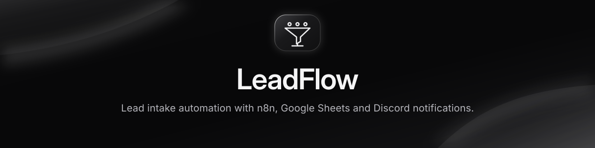
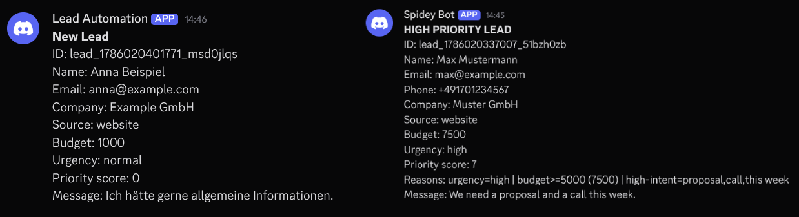
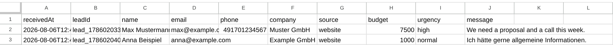
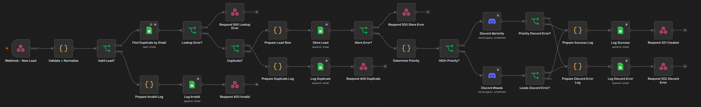

<div align="center">

<h1></h1>

[](./LICENSE)
[](https://docs.n8n.io/build/manage-workflows/export-and-import/)
[](#-demo)

[Quickstart](#-quickstart) · [Demo](#-demo) · [Sample request](./examples/sample-request.json)

</div>

## ✨ Why LeadFlow

A website inquiry needs a consistent path from form submission to follow-up. LeadFlow checks the payload, saves each new lead, and gives time-sensitive inquiries a separate Discord channel.

## 🧩 Features

- Normalize contact fields and look up duplicates by lowercased email.
- Store new leads in `Leads` and append validation, duplicate, delivery, and success events to `Logs`.
- Score urgency, budget, and intent to route leads to `#priority` or `#leads`.
- Return an HTTP response that identifies validation, storage, or notification outcomes.

## 🎬 Demo



<details>
<summary>Google Sheets example</summary>



</details>

## 🚀 Quickstart

1. Import [workflow.json](./workflow.json) into n8n.
2. Create the `Leads` and `Logs` spreadsheet tabs using the headers in [Configuration](#-configuration).
3. In each Google Sheets node, replace `REPLACE_WITH_GOOGLE_SHEET_ID` and select your Google Sheets OAuth2 credential.
4. Assign separate Discord webhook credentials to **Discord #priority** and **Discord #leads**.
5. Open **Webhook - New Lead**, select **Listen for Test Event**, and copy the Test URL. From the repo root, send the sample below after replacing the URL.

```bash
curl -i 'PASTE_N8N_TEST_URL_HERE' \
  -H 'Content-Type: application/json' \
  --data-binary @examples/sample-request.json
```

With a fresh email, expect HTTP `201`, a new row in `Leads`, and a message in the priority channel. Start another test listener and resend the same email to check the `409` path.

## 📖 Usage

Send JSON to the `POST` webhook. Include `name`, `email`, and `message`. The optional fields are `phone`, `company`, `source`, `budget`, and `urgency`. Messages can contain up to 5,000 characters after normalization.

| HTTP status | Meaning |
| --- | --- |
| `201` | Lead stored and Discord notification sent |
| `400` | Request failed validation |
| `409` | Email already exists in `Leads` |
| `500` | Google Sheets lookup or write failed |
| `502` | Lead stored, Discord delivery failed |

On `502`, use the returned `leadId` to find the stored lead. Resending the same email hits duplicate detection.

## 🏗️ Architecture



Lead storage happens before Discord delivery. The email lookup and append are separate operations, so simultaneous submissions can create duplicates.

## ⚙️ Configuration

<details>
<summary>Spreadsheet headers</summary>

**Leads**

```text
receivedAt	leadId	name	email	phone	company	source	budget	urgency	message
```

**Logs**

```text
timestamp	leadId	email	status	detail	priority
```

</details>

| Rule in Determine Priority | Points |
| --- | ---: |
| Urgency is `high`, `urgent`, `asap`, `sofort`, or `dringend` | 3 |
| Budget is at least 5,000 | 2 |
| Message or company contains an intent term such as `proposal`, `demo`, or `this week` | 2 |

A score of 3 or more routes to `#priority`. Other leads go to `#leads`.

> [!IMPORTANT]
> The export has an unauthenticated webhook. Configure access controls before publishing the Production URL, and restrict access to the Discord channels and spreadsheet because both receive lead contact details.

## 🛠️ Tech Stack

n8n, HTTP webhooks, JavaScript Code nodes, Google Sheets, and Discord.

## 📄 License

MIT License. See [LICENSE](./LICENSE).

---

<div align="center">
  <sub>Released under the <a href="./LICENSE">MIT License</a>. If this saved you time, a ⭐️ helps others find it.</sub>
</div>
